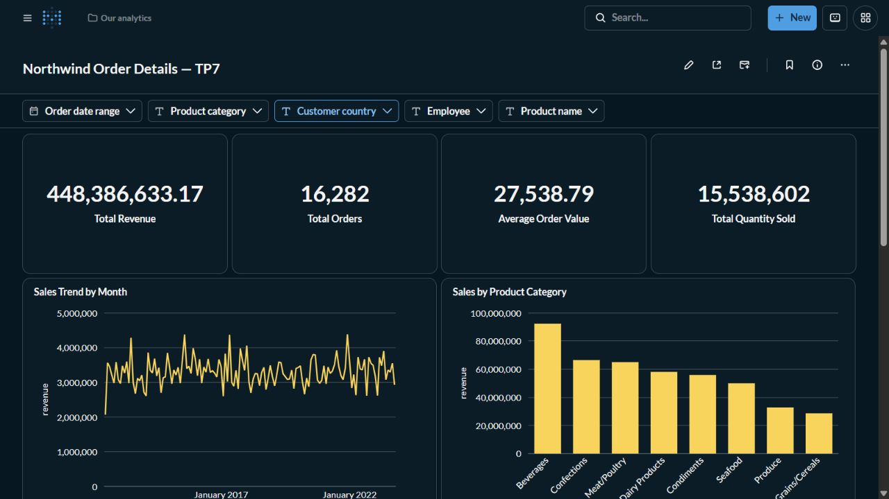

# DataVisualisation-TP2025 — TP7

Complete solution of the [teacher's TP7](https://github.com/ahmed3991/DataVisualisation-TP2025/blob/main/TP7/TP7.md): one Metabase dashboard with four KPIs, six charts and five filters, querying the TP6 Supabase `northwind_warehouse`.

- `TP7.ipynb` and `tp7.py`: create the dashboard and verify its real query/filter results.
- `create_dashboard.py`: reusable dashboard creation; reruns update its existing questions.
- `queries/`: the ten required SQL questions, all with date/category/country/employee/product field filters.
- `docker-compose.yml`: the teacher's Metabase + PostgreSQL application database setup.
- `EXPLICATION_AR.md`: Arabic explanation; `results/`: query CSVs, checks and report.

## Run

1. Complete TP6 so its warehouse tables exist in Supabase.
2. Copy `.env.example` to `.env`. Fill in Supabase credentials, choose a local application-database password and configure your own Metabase login after first setup.
3. With Docker installed, run `docker compose up -d`, then visit **http://localhost:8000** and complete Metabase's local first-user setup.
4. Install the Python requirements, then run `python tp7.py` or run all cells in `TP7.ipynb` locally.

```sh
python -m pip install -r requirements.txt
python tp7.py
```

The current computer has no Docker, so the live dashboard uses official Metabase v0.64.1 with portable Java 25 and a separate local PostgreSQL application database. Its sales data still come from Supabase. Restart helpers for this existing local installation are described in `LOCAL_RUN.md`.

The ignored `.secrets/metabase.json` contains the login for this local coursework instance. Passwords and session IDs are never included in notebooks, exported results or GitHub. Setup on a new instance uses your own login from `.env` or hidden input.

The notebook can recreate its companion files, but Metabase and Supabase must be reachable from the runtime. Colab cannot reach a Metabase server on your Windows `localhost`; use the notebook locally for the simplest workflow. GitHub stores the solution; it does not host the running dashboard. Keep Metabase and its application database running to view it.

To stop a Docker installation, run `docker compose down` (without `-v`, preserving its dashboard database).

Verified: both the notebook and the live dashboard work. All ten queries succeeded; the five filters and a combined selection reconciled with independent PostgreSQL calculations. A two-category selection was also checked in the browser. The default view is restored.



[Remaining charts](results/dashboard_products_countries.jpg)
